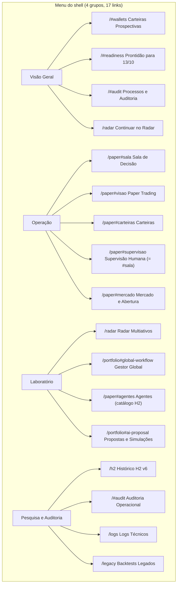

# Arquitetura de informação: sitemap atual e proposto

Consolida os entregáveis `CURRENT_SITEMAP`, `PROPOSED_SITEMAP` e
`INFORMATION_ARCHITECTURE`: os três descrevem a mesma estrutura em dois
momentos.

## 1. Sitemap atual (código de 12/10/2026)

| Rota | Arquivo | Conteúdo real | Problemas |
|---|---|---|---|
| `/` | `platform.html` | prontidão do próximo pregão, 5 carteiras prospectivas H2, cards de 4 ambientes, processos/auditoria | rótulo datado; mistura início e operação diária |
| `/paper` | `paper.html` | operação paper H2 v6 PETR4: visão, Sala de Decisão (+ supervisão), mercado, carteiras, catálogo de agentes | navegação própria; "Agentes" pertence ao H2 mas aparece em "Laboratório" |
| `/radar` | `radar.html` | execuções Radar, universo, preparo/preflight/lote pago, painel comparativo, detalhe do comitê ("Sala de Decisão") | navegação própria; nome repetido; "Premium V4" |
| `/portfolio` | `portfolio.html` | fluxo Global PM (V1 pago pela UI; V2 só leitura), "Proposta da IA" V6 (demos A–F), carteira contábil V5 sintética | três gerações; nome "Gestor de Carteira" × "Gestor Global"; V1 fechado com caminho pago |
| `/h2` | `h2.html` | 6 abas × 3 modos sobre o H2 v6 (somente leitura) | sem h1; ligado só a "Operação Paper Trading" |
| `/logs` | `logs.html` | stream de logs do pipeline ETL | identidade visual e linguagem de desenvolvedor |
| `/legacy` | `index.html` | backtests legados (10 ativos, 2016–2025) | estilo antigo; fica no grupo de pesquisa ao lado do H2 |

Evidências científicas (V7.5, V7.6, V7.6.1) **não aparecem na interface**:
existem só em `docs/evidence/`.

## 2. Princípios da proposta

1. Organizar por **objetivo do usuário**, não por versão ou origem técnica.
2. Separar **cinco naturezas de ação**: consulta, preparação, inferência paga,
   simulação e registro histórico (ver [DESIGN_SYSTEM_PROPOSAL.md](DESIGN_SYSTEM_PROPOSAL.md) §4).
3. Um conceito, um nome, um lugar ([NAMING_AND_TERMINOLOGY.md](NAMING_AND_TERMINOLOGY.md)).
4. **Uma** navegação global; dentro das páginas, abas locais só quando as
   vistas compartilham o mesmo objeto (o mesmo ativo, a mesma carteira).
5. Profundidade por **divulgação progressiva** (detalhes técnicos recolhíveis),
   nunca por modos que escondam estados críticos.
6. Versões e identidades científicas aparecem como **metadados** (selo
   "Tratamento V2", hash, link para evidência), nunca como nome de página.

## 3. Sitemap proposto

Seis áreas no menu principal, mais a Ajuda acessível de qualquer página
(botão "?" global). No máximo um nível de subnavegação.

```mermaid
flowchart TD
    H[Início] --- M[Mercado]
    H --- C[Carteira multiativos]
    H --- O[Operação diária PETR4]
    H --- P[Pesquisa]
    H --- A[Auditoria]
    H -.- Q["Ajuda (global)"]
    M --> M1[Ativos e indicadores]
    M --> M2["Radar: comitês por ativo"]
    M --> M3[Comparar ativos]
    C --> C1[Carteira hipotética]
    C --> C2["Gestor Global: propostas"]
    C --> C3[Simulações e demonstrações]
    O --> O1["Decisão do dia (deliberação + supervisão)"]
    O --> O2[Carteiras prospectivas]
    O --> O3[Mercado e abertura]
    P --> P1["Experimentos (H2 v6, multiativos)"]
    P --> P2[Resultados e comparações]
    P --> P3["Evidências e erratas"]
    P --> P4[Metodologia e protocolos]
    P --> P5[Backtests legados]
    A --> A1["Execuções e custos"]
    A --> A2["Registros (claims, journals, reservas)"]
    A --> A3[Diagnóstico e recuperação]
    A --> A4[Logs técnicos]
    Q --> Q1[Como funciona]
    Q --> Q2[Glossário]
    Q --> Q3[Perguntas frequentes]
```

**Diferença em relação à hipótese do enunciado:** a hipótese colocava as
"simulações paper" em "Carteira e Simulação". A auditoria mostra que a
operação paper do H2 v6 é uma **operação prospectiva em andamento**, com dados
oficiais diários, supervisão humana e carteiras virtuais próprias. Misturá-la
com a carteira hipotética multiativos repetiria o problema U4 ("Carteiras" com
dois sentidos). Por isso ela vira a área "Operação diária PETR4". A
"Carteira multiativos" fica só com o que é hipotético e consultivo.

## 4. Responsabilidade de cada página proposta

| Área / página | Responsabilidade | Natureza das ações | Origem atual | Relação |
|---|---|---|---|---|
| Início | o que é o laboratório, o que precisa de atenção hoje, por onde começar, estado de cada ambiente | consulta | `/` (parte) | aponta para todas as áreas |
| Mercado › Ativos e indicadores | série, indicadores e explicação de um ativo | consulta | `/legacy` (análise por ativo), `/paper#mercado` (PETR4) | entrada da jornada B |
| Mercado › Radar | execuções, universo, preparo e lote dos comitês; resultados por ativo | consulta, preparação, **inferência paga** | `/radar` | alimenta a Carteira |
| Mercado › Comparar ativos | pareceres lado a lado | consulta | `/radar` (painel) | — |
| Carteira › Carteira hipotética | capital, posições, caixa, recebíveis, limites | consulta, simulação | `/portfolio` (V5) | recebe pareceres do Radar |
| Carteira › Gestor Global | preparação, verificação, proposta, validação, registros | consulta, preparação, **inferência paga** (tratamento vigente) | `/portfolio#global-workflow` | lê pareceres; grava registros auditáveis |
| Carteira › Simulações e demonstrações | demos sintéticas V5/V6, cenários offline | simulação | `/portfolio#ai-proposal`, carteira V5 | rótulo "Demonstração sintética" obrigatório |
| Operação diária › Decisão do dia | deliberação H2, preflight, execução paga, supervisão humana | preparação, **inferência paga**, aprovação humana | `/paper#sala` | — |
| Operação diária › Carteiras prospectivas | 5 carteiras virtuais H2 | consulta | `/paper#visao`, `#carteiras`, `/#wallets` | — |
| Operação diária › Mercado e abertura | preços observados, cenários de abertura | consulta, simulação | `/paper#mercado` | — |
| Pesquisa › Experimentos | H2 v6 (6 abas), protocolo multiativos | registro histórico | `/h2`, `docs/evidence` | — |
| Pesquisa › Evidências e erratas | pacotes V7.x com estado, hashes e erratas | registro histórico | só `docs/` hoje | **nova** (somente leitura) |
| Pesquisa › Metodologia | protocolos, pré-registro, conclusões permitidas | registro histórico | só `docs/` | **nova** |
| Pesquisa › Backtests legados | export estático | registro histórico | `/legacy` | — |
| Auditoria › Execuções e custos | Radar runs, registros Global PM, reservas, pisos, cobrança desconhecida | consulta | `/#audit`, cards do Radar | — |
| Auditoria › Registros | claims, journals, selos, integridade | consulta | `/#audit` | — |
| Auditoria › Diagnóstico e recuperação | `check_platform`, replay offline | consulta, recuperação offline | `/#audit`, botões "Recuperar somente offline" | — |
| Auditoria › Logs técnicos | stream de logs | consulta | `/logs` | — |
| Catálogo de agentes | perfil dos analistas H2 | consulta | `/paper#agentes` | vai para Pesquisa › Experimentos (H2) |

## 5. Compatibilidade de rotas

As rotas atuais continuam respondendo (adaptadores e redirecionamentos), e
nenhuma chave de API ou contrato muda. Mapeamento sugerido:
`/paper#sala` → `/operacao/decisao`; `/radar` → `/mercado/radar`;
`/portfolio#global-workflow` → `/carteira/gestor`; `/h2` →
`/pesquisa/h2`; `/#audit` → `/auditoria`. O desenho final de URLs é decidido
no marco UX-M3 ([UX_MIGRATION_PLAN.md](UX_MIGRATION_PLAN.md)).
