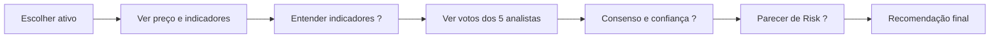

# Jornadas do usuário: atual × proposta

Perfis: **iniciante** (pouco conhecimento de finanças/IA), **intermediário**
(explora sinais e carteiras), **pesquisador** (contratos, evidências,
reprodutibilidade) e **operador técnico** (prepara, verifica, autoriza,
diagnostica). Uma mesma tela atende vários perfis por divulgação progressiva.

---

## A. Primeiro acesso

| Pergunta | Hoje | Proposta |
|---|---|---|
| O que é o laboratório? | h1 "Seu laboratório, em uma só visão."; nenhum parágrafo explicativo | bloco "O que é" de 3 linhas no Início + "Como funciona" na Ajuda |
| Opera dinheiro real? | selo "LOCAL · SEM ORDENS REAIS" no shell (bom, mas pequeno) | faixa fixa "Nenhuma ordem real é enviada. Carteiras são virtuais ou hipotéticas." com "?" |
| Por onde começar? | "Atenção necessária" orientada ao operador do pregão | três entradas: "Entender um ativo", "Montar uma carteira hipotética", "Ver resultados da pesquisa" |
| Quais módulos existem? | 4 grupos com nomes de origem técnica | 6 áreas por objetivo, cada uma com uma frase |
| Onde estão os dados? | não dito | cartão "Fontes de dados: B3 COTAHIST oficial…" com "?" |
| Simulação × inferência real? | cards de ambientes com selos textuais | selos visuais padronizados (Demonstração sintética, Inferência oficial, Resultado consultivo…) |
| O que custa dinheiro de API? | parágrafos em cada fluxo | ícone e cor de "Inferência paga" em todo botão que pode cobrar; nenhuma ação paga no Início |

**Atrito atual:** o Início é um painel do operador do próximo pregão (12/13
out.), não uma porta de entrada.

## B. Analisar um ativo

| Passo | Hoje | Lacuna |
|---|---|---|
| Escolher ativo | `/radar` (universo) ou `/legacy` (análise por ativo, dados antigos) | dois lugares, gerações diferentes |
| Indicadores | `/legacy` tem gráficos de RSI/MACD/Bollinger; o Radar mostra números no painel | sem explicação; gráficos e pareceres em páginas distintas |
| Analistas e consenso | detalhe do comitê ("Sala de Decisão") no `/radar` | nome ambíguo; confiança sem ressalva visível |
| Risk | coluna "Risco consultivo" | veto determinístico × parecer de LLM não distinguidos visualmente |
| Resultado | "Recomendação" | falta dizer "não é ordem" no ponto da recomendação |

**Proposta:** página do ativo em Mercado com abas locais "Preço e
indicadores", "Comitê" e "Risk", com "?" em cada indicador e um selo da origem
do parecer (LLM consultivo × regra determinística).

## C. Analisar vários ativos

Radar → comitês → resultados → comparação → seleção → Gestor Global.

| Passo | Hoje | Proposta |
|---|---|---|
| Lote de comitês | `/radar`, passos 1-2-3 com consentimento inline | mesmo fluxo, com o componente padrão de etapas e a confirmação de custo padrão |
| Comparação | "Sinais, lado a lado" + "Comparar duas empresas" | mantém; adiciona "por que não é ranking" (?) |
| Levar ao Gestor | "Levar seleção ao Gestor Global →" | mantém, mostrando que a seleção vai **com hashes** e que COMPRA não obriga compra |
| Mensagem central | presente em texto ("Parecer individual ≠ ordem…") | cartão fixo "Recomendação ≠ ordem; o gestor pode manter caixa; sem COMPRA, compra é proibida" |

## D. Montar uma carteira hipotética

| Conceito | Hoje | Proposta |
|---|---|---|
| Capital, posições, caixa, recebíveis | V5 sintético no fim de `/portfolio`; o fluxo V7 só aceita caixa inicial | "Carteira hipotética" com estado explícito (caixa disponível, reservado, recebível D+2) e "?" em cada termo |
| Restrições, custos, exposição, risco global | espalhados entre V5 e V6 | painel "Limites" único (concentração 40%, exposição 85%, veto, custo) |
| Pesos-alvo e proposta | "Proposta da IA" (demos V1) e registros do fluxo V7 | "Gestor Global › Propostas", com o tratamento como selo |
| Preparação → verificação → autorização → resultado | 4 botões numerados, rótulos técnicos ("Preparar snapshot e Risk · sem Gemini", "Preflight global") | stepper com estados distintos: **Preparar** (cria registro, sem custo) → **Verificar requisitos** (sem custo) → **Autorizar custo** (diálogo padrão) → **Resultado** (validado/rejeitado) |

Estados visualmente distintos são obrigatórios: preparado, bloqueado, pronto
para autorizar, em execução, válido, rejeitado, expirado.

## E. Pesquisador

| Necessidade | Hoje | Proposta |
|---|---|---|
| Tratamentos e versões | só em documentos e CLI | "Pesquisa › Metodologia": lista de tratamentos com estado (vigente, fechado), hash do contrato e link para evidência |
| Contratos, evidências, erratas | só `docs/evidence/` | "Pesquisa › Evidências": pacotes com estado e hashes, somente leitura |
| Experimentos e resultados | `/h2` (6 abas × 3 modos) | mantém o conteúdo; muda o título e os selos de estado ("Provisória", "Oficial", "Demonstração") |
| Testes e reprodutibilidade | ausentes da UI | página de reprodutibilidade com os comandos e o último resultado registrado |
| Limitações e conclusões permitidas | ausentes | seção fixa em Metodologia |

## F. Auditoria e falhas

| Necessidade | Hoje | Proposta |
|---|---|---|
| Erros e bloqueios | "Atenção necessária" e estados por página | Auditoria › Diagnóstico concentra bloqueios, com link para a tela de origem |
| Status de execução, resultados rejeitados | em cada fluxo | Auditoria › Execuções: tabela única (Radar, Global PM, agentes H2), filtros por estado |
| Registros imutáveis, claims, journals | `/#audit` resumido | Auditoria › Registros: selos e integridade; **sem** conteúdo de journals privados |
| Recuperação | botões "Recuperar somente offline" espalhados | Diagnóstico › Recuperação, sempre marcada "sem nova chamada" |
| Logs | `/logs` | Auditoria › Logs técnicos, com identidade visual da plataforma |

Controles operacionais com efeito (preparar, autorizar, recuperar) **não**
aparecem misturados a visualizações comuns: ficam em blocos de ação
identificados pela natureza da ação.
