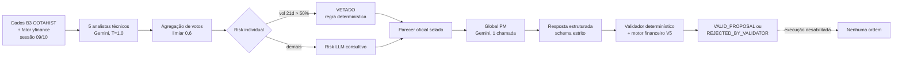
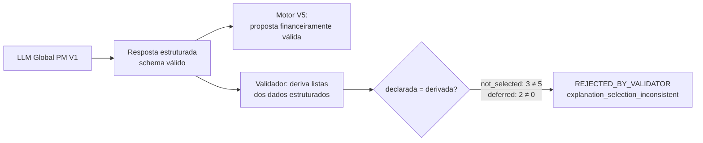

# Relatório científico — Radar multiativo e Global PM V1 × V2 (V7.5)

**Projeto:** Hedge-fund-lab: Laboratório Quantitativo de Backtesting baseado em
Sistemas Multiagentes (CEFET/RJ).
**Natureza:** consolidação documental de evidências já produzidas. Nenhuma
inferência nova, chamada paga, operação financeira ou alteração de registro foi
feita nesta etapa.
**Estado:** rascunho para revisão humana.

Convenções: "observado" designa um campo lido de um registro selado; "derivado",
um valor recalculado deterministicamente (ver [METRICS.json](METRICS.json));
"interpretação", uma leitura humana. Os horários estão em BRT (UTC−3), salvo
indicação. Referências bibliográficas ainda não coletadas aparecem como
**[REFERÊNCIA PENDENTE: …]**.

---

## 1. Introdução e escopo

O laboratório investiga o uso de agentes baseados em modelos de linguagem
(LLMs) em análise técnica, deliberação, gestão de risco e apoio à decisão de
carteira. Este relatório cobre uma única linha exploratória:

1. o **Radar multiativo** (`HFL-MULTIASSET-RADAR-V1`), execução oficial
   `radar-2026-10-09-recovery-01`, sessão de 09/10/2026, universo PETR4, VALE3,
   ITUB4, WEGE3 e BBAS3;
2. o **Gestor Global de Carteira** (Global PM), em duas identidades
   científicas distintas: `HFL-MULTIASSET-GLOBAL-PM-V1` e
   `HFL-MULTIASSET-GLOBAL-PM-V2`, cada uma com uma inferência real.

**Fora do escopo.** O experimento H2 v6 (PETR4) tem protocolo, manifests e
avaliação próprios; sua avaliação OA1 apresentou resultados negativos nas
janelas de validação ([H2_V6_OA1_VALIDATION_SCIENTIFIC_SUMMARY.md](../../H2_V6_OA1_VALIDATION_SCIENTIFIC_SUMMARY.md)).
Esses resultados não são reinterpretados nem combinados com os deste relatório,
e o Final Test do H2 permanece bloqueado e não executado. O H2 aparece aqui só
para situar a evolução da arquitetura: o Radar reutiliza componentes do
analista técnico e do Risk desenvolvidos no H2, aplicados a vários ativos e
sem avaliação de desempenho.

## 2. Objetivos da avaliação exploratória

- **O1.** Descrever o comportamento observado do pipeline Radar → Risk
  individual → Global PM → validador determinístico sobre uma sessão real.
- **O2.** Caracterizar a rejeição da primeira inferência do Global PM V1.
- **O3.** Documentar a evolução versionada do contrato (V2) e a primeira
  inferência V2, separando conformidade contratual de intenção econômica.
- **O4.** Contabilizar o uso computacional informado, distinguindo tokens,
  pisos de custo, reservas e cobrança.

Não são objetivos desta etapa, e não foram avaliados: rentabilidade, alfa,
risco prospectivo, superioridade de um tratamento sobre outro ou benefício
causal da arquitetura multiagentes.

## 3. Arquitetura e agentes envolvidos

| Componente | Natureza | Papel | Evidência |
|---|---|---|---|
| Analista técnico (×5 por ativo) | LLM (`gemini-3.8-flash`, temperatura 1,0, sementes 10001–10005) | Voto COMPRA/MANTER/VENDA com confiança e códigos de evidência de um vocabulário fechado | `votes` em cada `result.json` do Radar |
| Agregação do comitê | determinística | Sinal vencedor com limiar de 0,6; confiança técnica = soma das confianças dos votos vencedores ÷ total de analistas | `consensus`, `technical_signal` |
| Risk individual | LLM consultivo **ou** regra determinística | Parecer APROVADO/VETADO por ativo; veto automático quando a volatilidade anualizada de 21 sessões excede 50% | `risk`, `risk_source` |
| Global PM | LLM, uma chamada por tratamento | Proposta coordenada de carteira hipotética para o capital compartilhado | `response` nos registros V1/V2 |
| Validador global | determinístico (V1: código; V2: `GLOBAL_PM_VALIDATION_V2`) | Invariantes de identidade, hashes, universo, listas, veto, métricas citadas | `validation` |
| Motor financeiro V5 | determinístico | Caixa liquidado, custódia, custos, liquidação D+2, Risk projetado | `validation.financial_validation` |
| Execução | desabilitada (`CONSULTATIVE_ONLY_V1`) | Nenhuma ordem é gerada | `execution_enabled: false` |

O Global PM não vê os dados brutos de mercado: recebe os cinco pareceres
oficiais selados, o estado da carteira hipotética, históricos para risco e as
políticas didáticas. A geração da proposta (LLM) e sua validação (código
determinístico) são independentes: o validador não reescreve nenhum campo do
modelo (`normalization: NONE`).

## 4. Dados e proveniência

- **Mercado.** Barras OHLCV oficiais da B3 (COTAHIST 2025 e 2026, `TPMERC 010`,
  `CODBDI 02`) com fator de ajuste do yfinance; 311 sessões desde 16/07/2025;
  bonificação de ITUB4 (26/12/2025) normalizada com corroboração B3
  ([../hfl_radar_v73/README.md](../hfl_radar_v73/README.md), seção 6).
- **Equivalência com o lote original.** Os inputs da recuperação foram
  comparados aos do lote original: mesmos COTAHIST (mesmo SHA-256), mesmas
  features e métricas de risco dentro das tolerâncias declaradas
  (`EQUIVALENT_WITHIN_TOLERANCE` nos cinco ativos; única diferença em feature:
  RSI de ITUB4 76,557382 → 76,557381).
- **Carteira.** Hipotética, R$ 100.000,00 em caixa liquidado, sem posições;
  preços hipotéticos constantes; política de alocação
  `EXPLORATORY_ALLOCATION_V1` e política de risco
  `V5_DIDACTIC_FIXTURE_NOT_APPROVED_FOR_PILOT`.
- **Classificação das evidências.** PRIMARY, DERIVED, DIAGNOSTIC,
  INTERPRETATIVE e SYNTHETIC, com SHA-256 de cada fonte e matriz de
  proveniência (qual fonte sustenta cada tabela e conclusão) em
  [EVIDENCE_MANIFEST.json](EVIDENCE_MANIFEST.json).
- **Disponibilidade.** Os registros primários (`data/radar/…`,
  `data/global_pm/…`, `data/platform/…`) são locais e não versionados no Git.
  Sem eles, a reprodução se limita à leitura das evidências versionadas
  ([REPRODUCIBILITY.md](REPRODUCIBILITY.md)).

Os registros sintéticos (18 resultados Global PM com
`FAKE_GLOBAL_PM_NOT_GEMINI`, incluindo a qualificação V2 A–F e o registro de
demonstração `v7-3558…`) e a execução `radar-demo-v4` não entram em nenhum
resultado deste relatório.

## 5. Procedimento experimental

### 5.1 Sequência reconstruída

| # | Etapa | Instante (BRT) | Fase | Evidência |
|---|---|---|---|---|
| 1 | Universo multiativo definido (5 ativos) no tratamento `HFL-MULTIASSET-RADAR-V1` | antes de 11/10 | preparação | registry (`universe`) |
| 2 | Obtenção dos dados da sessão de 09/10 e preparo dos inputs do lote original | 11/10 13:55 (ITUB4 refeito em 12/10 02:41) | preparação | `compare_recovery_vs_original.json` |
| — | **Incidente:** lote pago original; 25 chamadas bloqueadas localmente pelo guard offline, 0/5 comitês | 12/10 02:59:39–02:59:40 | inferência (falha de infraestrutura) | `forensics.json` |
| 2′ | Registro da recuperação e novo preparo dos inputs; equivalência confirmada | 12/10 12:58:49 – 13:03 | preparação | registry, `last_prepare.json` |
| — | Autorização humana do orçamento do lote | 12/10 14:53:26 | preparação | `budget_authorizations/…` |
| 3–6 | Analistas, agregação, Risk individual e pareceres oficiais (29 chamadas) | 12/10 14:58:02 – 14:59:51 | inferência | `analyses/*/2026-10-09/` |
| 7 | Contexto global V1 congelado | 12/10 15:18:04 | preparação | `context.json` V1 |
| 8 | Inferência Global PM V1 (16,9 s) | 12/10 15:26:47 | inferência | journal V1 |
| 9 | Validação: `REJECTED_BY_VALIDATOR` | 12/10 15:27:04 | validação | `result.json` V1 |
| 10 | Diagnóstico offline e contrafactual em memória | 12/10, antes de 16:18 | diagnóstico | `incident_reproduction.json` |
| 11 | Contrato V2 versionado (código, testes e mutações; commit `020d1cc`) | 12/10 16:18 | desenvolvimento | Git |
| 12 | Qualificação sintética V2, casos A–F (executada com o código V2 antes do commit) | 12/10 ≈ 16:12 | qualificação | `qualification.json` |
| 13 | Contexto global V2 congelado | 12/10 17:29:22 | preparação | `context.json` V2 |
| 14 | Inferência Global PM V2 (19,5 s) | 12/10 18:07:41 | inferência | journal V2 |
| 15 | Validação: `VALID_PROPOSAL` | 12/10 18:08:01 | validação | `result.json` V2 |
| 16 | Verificação de preservação (operador; confirmada de novo na V7.5) | 12/10 após 18:08 e 20:05 | verificação | `preservation_*.json` |

### 5.2 Separação temporal

Os **dados** são da sessão de 09/10/2026 (marca de avaliação às 19:00). Todas
as inferências ocorreram depois, em 12/10/2026, sobre inputs congelados: o lote
Radar cerca de 2 dias e 20 horas após o fechamento; as inferências globais,
cerca de 27 minutos (V1) e 3 h 08 min (V2) depois do fim do lote Radar. Nenhuma inferência
ocorreu durante o pregão de 09/10, e os resultados não descrevem decisões
tomadas em tempo real.

### 5.3 Incidente de infraestrutura

O lote original (`radar-2026-10-09-original`) falhou porque uma verificação
offline do servidor substituía as funções de conexão do processo inteiro; o
worker pago, em outra thread, não conseguiu conectar
([../hfl_incident_2026_10_12/README.md](../hfl_incident_2026_10_12/README.md)).
Nenhum envelope do provedor foi recebido e nenhum parecer foi produzido. O lote
foi preservado como `INCIDENT_PRESERVED`, com reserva incerta de US$ 3,31776
nunca liberada, e **não é contado** como comitê, voto ou inferência. A execução
oficial é a recuperação `radar-2026-10-09-recovery-01`, uma nova instância do
mesmo tratamento (mesmo manifesto `77d75777…`).

## 6. Resultados do Radar

Execução `radar-2026-10-09-recovery-01`, estado `COMPLETED`, integridade `OK`:
5/5 pareceres, 25/25 votos válidos, 29 chamadas sem erro nem retry.

| Ativo | Votos (C/M/V) | Sinal técnico | Confiança técnica | Vol. 21d anualizada | RSI | Risk | Origem do Risk | Recomendação final |
|---|---|---|---|---|---|---|---|---|
| PETR4 | 5/0/0 | COMPRA | 0,744 | 39,23% | 74,92 | APROVADO | LLM consultivo | COMPRA |
| VALE3 | 0/0/5 | VENDA | 0,790 | 23,77% | 32,86 | APROVADO | LLM consultivo | VENDA |
| ITUB4 | 5/0/0 | COMPRA | 0,750 | 42,92% | 76,56 | APROVADO | LLM consultivo | COMPRA |
| WEGE3 | 1/4/0 | MANTER | 0,476 | 21,52% | 55,62 | APROVADO | LLM consultivo | MANTER |
| BBAS3 | 5/0/0 | COMPRA | 0,750 | 54,48% | 62,35 | **VETADO** | regra determinística | **MANTER** |

Os valores conferem com a tabela de referência fornecida pelo operador. Duas
precisões que os registros acrescentam:

- O veto de BBAS3 não foi um parecer de um LLM: a regra
  `HARD_ASSET_VOLATILITY_RULE` vetou o ativo porque 0,544844 > 0,50, e o Risk
  LLM não foi chamado (por isso 29, e não 30, chamadas). A recomendação final
  passou de COMPRA para MANTER por efeito do veto.
- A "confiança técnica" é um agregado qualitativo dos votos, não uma
  probabilidade. Em WEGE3, 0,476 = (0,55 + 0,60 + 0,58 + 0,65) / 5, com um voto
  dissidente de COMPRA.

### 6.1 Matriz Radar → Risk → Global PM

| Ativo | Sinal agregado | Indicadores disponíveis (seleção) | Risk | Recomendação | V1 | V2 | Justificativa principal do gestor (texto do modelo) | Restrição determinística |
|---|---|---|---|---|---|---|---|---|
| PETR4 | COMPRA 5/5 | RSI 74,92; `bb_upper_gap` −0,0016; vol 39,23% | APROVADO | COMPRA | sem alocação | sem alocação; watchlist | RSI elevado, preferência por preservar caixa | nenhuma |
| VALE3 | VENDA 5/5 | abaixo de SMA50/200; MACD negativo; RSI 32,86 | APROVADO | VENDA | sem operação | sem operação | carteira sem custódia | venda exige unidades disponíveis |
| ITUB4 | COMPRA 5/5 | RSI 76,56; `bb_upper_gap` −0,0097; vol 42,92% | APROVADO | COMPRA | sem alocação | sem alocação; watchlist | RSI elevado, volatilidade | nenhuma |
| WEGE3 | MANTER 4/5 | RSI 55,62; MACD abaixo do sinal | APROVADO | MANTER | sem alocação | sem alocação | sinal neutro | nenhuma |
| BBAS3 | COMPRA 5/5 | vol 54,48% | VETADO | MANTER | sem alocação | sem alocação | veto de risco | veto: sem operação nem aumento de peso |

Três distinções decorrem da matriz:

1. **COMPRA não obriga compra.** PETR4 e ITUB4 tinham consenso unânime de
   COMPRA e Risk APROVADO; o contrato permite não alocar ("sinais favoráveis
   não obrigam alocação"), e os dois gestores não alocaram.
2. **VENDA não gera operação sem custódia.** VALE3 tinha VENDA 5/5, mas a
   carteira não tinha a ação; venda a descoberto não é admitida, então não há
   operação possível.
3. **Manter caixa pode ser válido sem demonstrar capacidade preditiva.** Uma
   carteira 100% em caixa satisfaz trivialmente limites de exposição,
   concentração e custo. A aprovação diz que a proposta é admissível, não que
   foi boa decisão.

## 7. Estudo de caso: rejeição do Global PM V1

### 7.1 O que o modelo produziu

Registro `v7-5a78ea5d15214e37bcae18f167ffcee3`. Proposta estrutural: caixa-alvo
1,0; cinco pesos zero; nenhuma operação; as cinco ações declaradas como
`NOT_SELECTED`. Listas declaradas:

- `not_selected = [BBAS3, VALE3, WEGE3]`
- `deferred_opportunities = [ITUB4, PETR4]`

O texto justifica a não alocação de ITUB4 e PETR4 como **adiamento de
investimento** ("adiando compras até que ocorram retrações técnicas").

### 7.2 O que o contrato V1 definia

No V1, as duas listas só eram definidas no código do validador:

| Lista | Definição implícita (código V1) | Derivada | Declarada |
|---|---|---|---|
| `not_selected` | tickers com `action == NOT_SELECTED` | os 5 ativos | 3 ativos |
| `deferred_opportunities` | tickers das compras que dependem da liquidação de uma venda (adiamento **por liquidação**, classificado pelo motor V5) | ∅ (não há operações) | ITUB4, PETR4 |

O prompt pedia "Explique seleção, exclusão, adiamento, caixa e risco" sem
definir os campos; o schema declarava as duas listas como `list[str]` sem
descrição. O nome "opportunities" e o verbo "adiamento" admitem a leitura
"oportunidade de mercado adiada", que é a leitura do modelo. O contrato, porém,
reservava o campo a uma dependência financeira entre operações.

### 7.3 Adiamento de investimento × adiamento por liquidação

| | Adiamento de investimento | Adiamento por liquidação |
|---|---|---|
| Natureza | intenção futura do gestor | dependência contábil dentro da proposta |
| Existe operação? | não | sim: uma compra cujo financiamento é o recebível de uma venda desta proposta |
| Exemplo | "comprar ITUB4 se o RSI recuar" | vender PETR4 hoje (recebível D+2) e comprar WEGE3 com esse recebível |
| Campo V1 | nenhum (não havia onde registrar) | `deferred_opportunities` |
| Campo V2 | `watchlist_candidates` (consultivo) | `settlement_deferred_operations` (IDs de operação) |

### 7.4 A inconsistência e o fluxo de rejeição

O validador derivou as duas listas dos campos estruturados (ação, peso,
operações) e comparou com as declaradas; as duas igualdades falharam. A
validação financeira V5 isolada foi aprovada (caixa R$ 100.000,00, exposição
0, Risk projetado `OK`), mas a validação global depende de todas as
invariantes, e a resposta foi rejeitada.

A decisão econômica (não investir) era plausível e coerente com os pesos. O
problema foi a **forma**: a resposta não satisfazia o contrato do tratamento.
Os registros não permitem atribuir a causa só ao prompt, só ao schema ou à
amostragem do modelo; essa atribuição exigiria repetições controladas
(ver [RESEARCH_GAPS.md](RESEARCH_GAPS.md)).

### 7.5 Contrafactual em memória

Na V7.4, uma cópia da resposta, só em memória, com
`not_selected = [os 5 ativos]` e `deferred_opportunities = []`, passou pelo
validador V1 completo como `VALID_PROPOSAL`, sem erros
(`DIAGNOSTIC_IN_MEMORY_ONLY_NOT_A_CORRECTION_NOT_SEALED`). A V7.5 reexecutou o
verificador somente leitura (`run_global_pm_v2.py incident`), e a saída foi
idêntica à evidência versionada.

O contrafactual mostra que, **naquele caso**, a correção das duas listas era
suficiente para satisfazer o validador V1. Ele não é uma segunda inferência,
não valida o texto livre (que o V1 não verifica) e não prova a eficácia geral
de um novo contrato.

### 7.6 Afirmações do texto livre sem suporte

A auditoria manual da V7.4 ([../hfl_global_pm_v2/README.md](../hfl_global_pm_v2/README.md),
seção 9) encontrou afirmações não sustentadas pelo contexto. A V7.5 confirmou
de forma determinística os pontos verificáveis:

- "rompimento de banda superior de Bollinger" em ITUB4: o contexto tem
  `bb_upper_gap = −0,009664` (fechamento **abaixo** da banda) e o código de
  evidência `CLOSE_INSIDE_BOLLINGER` (`gpm_v1.itub4_close_inside_upper_band =
  true`). A expressão aparece também no parecer do Risk individual de ITUB4,
  outro LLM; o Global PM a repetiu.
- "correlação histórica de ITUB4 e PETR4 com o setor financeiro" e
  "volatilidade setorial": o contexto não tem setores
  (`sector_status = NOT_EVALUATED_NO_RELIABLE_METADATA`), e PETR4 não pertence
  ao setor financeiro.
- "evitar risco de correção imediata": previsão apresentada como fundamento.

Nenhuma dessas afirmações motivou a rejeição; o V1 não verificava texto livre.

### 7.7 Versionamento e não correção retroativa

A V1 não foi corrigida nem reclassificada. Os hashes do código V1 estão selados
em todo contexto V1; editá-lo invalidaria a verificação do registro real. A
correção virou um tratamento novo (V2), com identidade, prompt, schema, contrato
e política de validação próprios. Assim, a rejeição da V1 continua sendo uma
observação válida do tratamento V1, e a V2 é avaliada pelos próprios critérios.

## 8. Evolução contratual V2

### 8.1 Mudanças

| Mudança | Efeito |
|---|---|
| `not_selected` derivável | igual aos tickers com ação `NOT_SELECTED` (⇔ peso zero e sem operação) |
| `watchlist_candidates` | observação consultiva sem quantidade, preço, peso, dependência ou autorização; sinal igual ao do parecer; proibida em ativo com operação |
| `settlement_deferred_operations` | IDs de operações, não tickers; igual às compras que dependem da liquidação de uma venda desta proposta |
| `cited_metrics` | números citados só com chaves de `verifiable_metrics` congeladas, conferidos com arredondamento half-even |
| Veto em pesos-alvo | ativo VETADO: nenhuma operação e peso-alvo ≤ atual |
| Status selado × validade | a expiração não muda o status selado |
| Texto livre | rotulado como interpretação do modelo, não verificado |
| Erros específicos | um código por invariante (I1–I20) |

### 8.2 Avaliação da resposta oficial V2

| Verificação | Resultado | Base |
|---|---|---|
| Hashes de contexto, snapshot e pareceres copiados corretamente | sim | validador V2 sem erros; `opinion_refs` = hashes do contexto |
| Pareceres do contexto apontam para os `result.json` do Radar | sim (5/5) | `gpm_v2.integrity` |
| Veto de BBAS3 preservado | sim: peso 0, sem operação | I13; `gpm_v2.integrity` |
| Cinco ativos classificados | sim: todos `NOT_SELECTED` e todos em `not_selected` | I18, I19 |
| Watchlist separada das operações | sim: ITUB4 e PETR4 só em observação, sem operação; `settlement_deferred_operations = []` | I15, I20 |
| Sinal da watchlist = parecer | sim (COMPRA, COMPRA) | I10; `gpm_v2.watchlist_signals_match` |
| Pesos + caixa = 100% | sim (1,00) | I7 |
| Caixa e custódia consistentes | sim: caixa liquidado R$ 100.000,00, sem posições, sem recebíveis | V5 |
| Riscos projetados dentro das políticas | sim: exposição 0, Risk projetado `OK` | V5 |
| Métricas citadas conferem | 13/13 | I12; `gpm_v2.cited_metrics` |
| Dados não fornecidos | nenhum termo de setor; ver 8.3 sobre o texto livre | `gpm_v2.free_text_terms` |

### 8.3 Limites da validação do texto livre

`VALID_PROPOSAL` certifica as invariantes estruturais, não toda a
fundamentação. O texto livre da resposta V2 ainda contém, por leitura humana:

- **"teto regulamentar de 0.50"** para o limite de volatilidade de BBAS3. O
  limite é uma política didática interna do laboratório
  (`V5_DIDACTIC_FIXTURE_NOT_APPROVED_FOR_PILOT`), não uma norma regulatória; o
  rótulo não tem suporte no contexto.
- **"sinalizam sobrecompra e risco de correção imediata"**: a primeira parte é
  uma leitura convencional de RSI acima de 70
  **[REFERÊNCIA PENDENTE: definição de sobrecompra pelo RSI]**; a segunda é
  linguagem preditiva, que o prompt V2 pede para não apresentar como
  observação.
- **volatilidades elevadas "sinalizam sobrecompra"**: volatilidade não é
  indicador de sobrecompra; trata-se de imprecisão conceitual do texto.

Não há menção a setores, índices, notícias ou fundamentos (proxy lexical em
`gpm_v2.free_text_terms`; não substitui a leitura humana). A V2 reduziu, mas não
eliminou, afirmações sem suporte no texto livre, e o validador não foi
desenhado para detectá-las.

## 9. Comparação V1 × V2

Tabela completa, distinção entre intenção, conformidade, validação financeira e
resultado financeiro, e decisão por ativo:
[COMPARISON_V1_V2.md](COMPARISON_V1_V2.md).

Síntese: mesma sessão, mesmos cinco pareceres, mesmo modelo e opções; a mesma
intenção econômica (100% em caixa, nenhuma operação); resultados contratuais
opostos (V1 rejeitada, V2 válida), cada um segundo o próprio contrato. Nenhum
resultado financeiro foi observado em nenhum dos dois.

## 10. Consumo computacional e custo

Detalhamento em [COST_ACCOUNTING.md](COST_ACCOUNTING.md).

| | Radar recovery (29 chamadas) | Global PM V1 | Global PM V2 |
|---|---|---|---|
| Tokens totais informados | 34.847 | 21.313 | 23.503 |
| Pensamento | informado em 1/29 chamadas | não informado | não informado |
| Piso observado (USD) | 0,04313925 | 0,02354175 | 0,02626725 |
| Reserva (USD) | 3,31776 | 0,159744 | 0,159744 |
| Cobrança confirmada | desconhecida | desconhecida | desconhecida |

## 11. Discussão

**Intenção × conformidade.** O caso V1 separa duas propriedades que costumam
ser confundidas em sistemas baseados em LLM: a decisão substantiva do modelo e
a aderência formal da resposta a um contrato verificável. A decisão foi a mesma
nos dois tratamentos; a conformidade não. Num sistema em que a validação é
independente da geração, uma resposta substantivamente aceitável mas
formalmente incoerente é rejeitada, e esse é o comportamento esperado do
mecanismo **[REFERÊNCIA PENDENTE: validação de saídas estruturadas de LLMs /
design by contract]**.

**A rejeição como evidência do mecanismo.** A rejeição V1 mostra que o
validador detectou uma divergência real entre o que o modelo declarou e o que
os próprios dados estruturados implicavam, sem corrigir nenhum campo. Esse é um
caso único: não estima taxas de falso positivo ou falso negativo do validador.

**O que a aprovação V2 exercitou.** A proposta V2 não tinha operações. As
invariantes de operações (liquidação, dependências, dimensionamento, custos,
custódia em vendas) só foram exercitadas nos casos sintéticos B, C, D e F da
qualificação e nos testes, nunca numa resposta real. A aprovação real cobre as
invariantes de identidade, hashes, universo, listas, watchlist, veto em pesos e
métricas citadas.

**Evolução orientada por diagnóstico.** A V2 foi desenhada depois de observada a
falha da V1, e sua primeira inferência é a única observação real do novo
contrato. A sequência é uma iteração de engenharia documentada, não uma
validação confirmatória independente: a conformidade da V2 numa única chamada
não estima a taxa de conformidade do tratamento nem prova que o novo contrato
cause menos rejeições.

**Deliberação multiagente.** Na sessão estudada, o Global PM não seguiu os
sinais técnicos favoráveis (PETR4, ITUB4) e justificou a decisão com
indicadores de cautela já presentes nos pareceres (RSI, volatilidade). O
registro mostra que o gestor pode divergir dos comitês dentro das restrições;
não mostra se essa divergência melhora ou piora decisões
**[REFERÊNCIA PENDENTE: sistemas multiagentes baseados em LLM em finanças]**.

**Propagação entre agentes.** O erro "rompimento de Bollinger" nasceu no texto
do Risk LLM de ITUB4 e foi repetido pelo Global PM V1. Textos de agentes
anteriores entram como dados e podem carregar afirmações factualmente erradas;
só a parte numérica com vocabulário fechado (V2) é conferível.

## 12. Ameaças à validade

Análise completa e mitigação proposta em
[THREATS_TO_VALIDITY.md](THREATS_TO_VALIDITY.md). As principais: uma sessão e
duas inferências globais; tratamentos diferentes; ausência de repetição;
variação estocástica (temperatura 1,0); dependência de dados históricos e de
carteira hipotética; entradas produzidas por outros LLMs; cobertura limitada da
validação textual; ausência de ordens reais; e seleção posterior (V2 desenhada
após a falha da V1).

## 13. Limitações

- Não há desempenho financeiro a relatar: nenhuma posição foi aberta, nenhuma
  ordem executada, nenhum período prospectivo avaliado.
- As métricas observáveis são contagens e verificações de integridade sobre
  n = 1 sessão, 5 comitês e 2 inferências globais.
- O custo monetário é só um piso: o pensamento não foi informado e a fatura não
  foi consultada.
- A validação do texto livre é manual e parcial; o proxy lexical não tem valor
  semântico.
- A reprodução completa depende de registros locais não versionados.
- A auditoria cobre os artefatos deste escopo; não reavalia o H2 nem as
  qualificações sintéticas anteriores.

## 14. Conclusões sustentadas

1. O Radar produziu cinco pareceres oficiais para a sessão de 09/10/2026, com
   25/25 votos válidos e um veto determinístico de risco (BBAS3, volatilidade
   0,5448 > 0,50). [`radar.*`]
2. O lote original afetado pelo bloqueio de rede não produziu pareceres e foi
   preservado separadamente; não é contado como comitê. [`radar.original_incident`]
3. A primeira inferência do Global PM V1 propôs manter 100% em caixa e foi
   corretamente rejeitada (`explanation_selection_inconsistent`), porque as
   listas declaradas divergiam das derivadas dos dados estruturados; a
   validação financeira isolada foi aprovada. A rejeição permanece. [`gpm_v1.outcome`]
4. Para aquele caso, o contrafactual em memória mostrou que corrigir as duas
   listas bastava para satisfazer o validador V1; isso não constitui uma
   segunda inferência nem uma prova de eficácia geral. [incident_reproduction]
5. Após evolução versionada do contrato, a primeira inferência do tratamento V2,
   sobre os mesmos pareceres, foi classificada como `VALID_PROPOSAL`, com a mesma
   intenção econômica (100% em caixa), as 13 métricas citadas conferidas e o
   veto preservado. [`gpm_v2.*`]
6. A validação estrutural não certifica a fundamentação textual: as duas
   respostas contêm afirmações sem suporte no contexto (mais numerosas na V1).
7. Os resultados não permitem inferir superioridade estatística, financeira ou
   de eficiência entre V1 e V2, nem benefício causal da arquitetura multiagentes.

Formulação síntese: *a investigação exploratória identificou uma inconsistência
entre a semântica produzida pelo modelo de linguagem e o contrato de validação
determinística. Após evolução versionada do contrato, uma nova inferência foi
classificada como válida pelas invariantes do tratamento V2, mantendo-se a
independência entre geração da proposta e validação financeira. Os resultados
não permitem inferir superioridade estatística ou financeira entre os
tratamentos.*

## 15. Trabalhos futuros

Perguntas em aberto, priorizadas por valor científico e viabilidade:
[RESEARCH_GAPS.md](RESEARCH_GAPS.md). Nenhuma delas foi iniciada nesta etapa.
